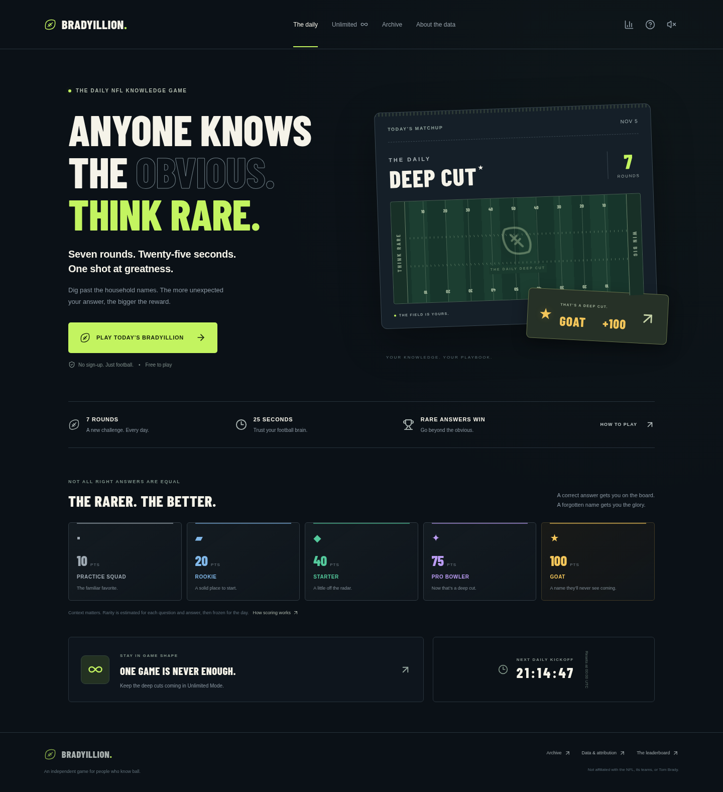

# Bradyillion 🏈

Seven rounds. Twenty-five seconds. Rare answers win.

An independent NFL knowledge game built with Next.js, React, TypeScript, PostgreSQL, and versioned nflverse records. See [the full product specification](docs/PRODUCT_SPEC.md), [data definitions](docs/DATA.md), and [implementation status](docs/STATUS.md).



See [validation evidence](docs/VALIDATION.md) and the [mobile preview](docs/preview-mobile.png).

## Run

Node 22–24 and npm:

```sh
npm ci
npm run dev
```

Development runs on port 3000 and persists embedded PostgreSQL in `.data/`. No API key or live sports API is needed. Set `DATABASE_URL` for external PostgreSQL; tables initialize automatically. Use a single process for an embedded database.

```sh
npm run lint
npm run typecheck
npm test
npm run data:audit
npm run build
npm start
```

Run browser tests in a separate terminal (the default configuration starts its own dev server):

```sh
npx playwright install chromium
npm run test:e2e
```

## Render preview

[Deploy to Render](https://render.com/deploy?repo=https://github.com/jbartels1610/bradyillion), or choose **New → Blueprint** in Render, connect this repository, and select `main`. Review/apply `render.yaml`; it creates the web app and PostgreSQL and generates an admin token. When the build and `/api/health` succeed, open the Render-assigned HTTPS address. See [deployment details](docs/DEPLOYMENT.md).

Free web instances may sleep, and free PostgreSQL expires after 30 days. Review current Render pricing before applying. Upgrade before retaining real user progress. A source commit and Blueprint do not themselves create a live deployment.

## Rules and trust

The server owns 25-second deadlines, three recognized wrong attempts, frozen daily scoring, and results. Seven rounds score at most 700. Editorial rarity awards 10, 20, 40, 75, 100 points; it does not pretend to measure real player popularity. Daily reset is 00:00 UTC. Anonymous cookies preserve a profile but do not establish account-backed identity. Practice does not affect ranked scores.

Questions explicitly state available source years. Unsupported all-time, coaching, award, and Super Bowl categories are excluded until reliable records are imported. No fake users or leaderboards are populated.

## Independent project

Unaffiliated with the NFL, its teams, or Tom Brady. No team logos or player photographs are used. Review the working name and source-owner commercial data rights before a commercial launch. Data attribution and limitations are in `docs/DATA.md`.
